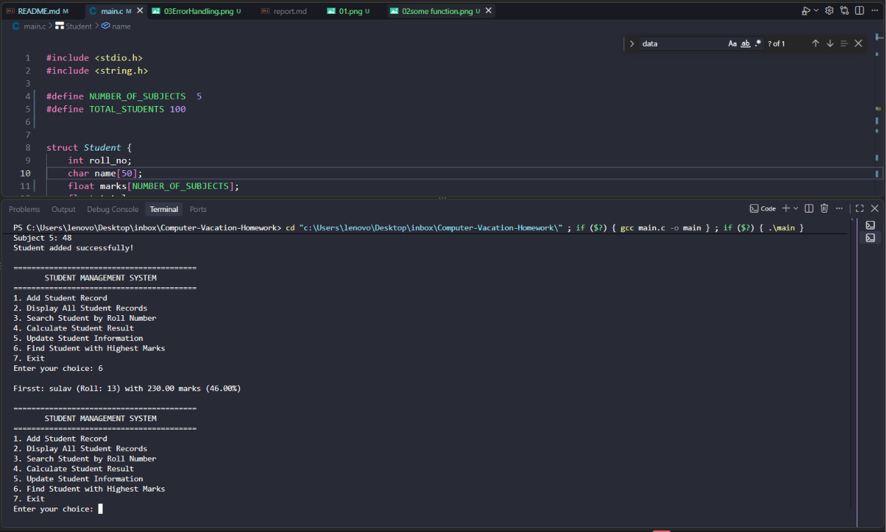
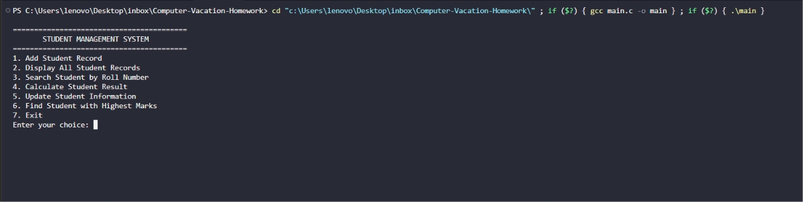
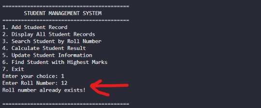

# Computer-Vacation-Homework
 Student Record Management System

## Objective
To complete the assignment of vacation homework

Picture (of the main program)

 

## Algorithm

Step 1: Start

Step 2: Define Structure (Roll no, Name, Marks array, Total marks, Percent, result)

Step 3: Declare array of Student structures and initialize a variable count = 0 to keep track of the number of registered students.

Step 4:

Enter a do-while loop to display the main menu options:

Add Student Record

Display All Student Records

Search Student by Roll Number

Calculate Student Result

Update Student Information

Find Student with Highest Marks

Exit

Step 5: Read the user's menu choice.

Step 6: Use corresponding function.

Step 7: Terminate the program when the user selects corresponding option.

Step 8: Handle invalid choices with a default case warning message.

Step 9: Stop.

## Flowchart

Some Screenshots

 
 
 
 

 
 
 
 

